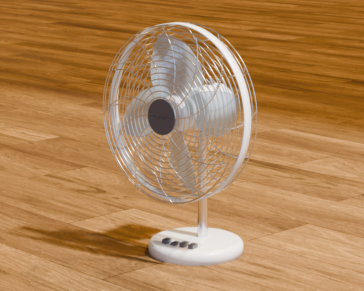

# Table Fan Generator Manual

This add-on generates only fans, yet is should still be safe for work 😂

## Overview

Table Fan Generator is a Blender add-on that creates a parametric axial desktop fan. It can build a multi-blade rotor, protective front and rear cage, center badge, motor housing, desk stand, materials, and optional animation. Generated parts are placed in a collection named `Axial Fan (N Blades)`.

The add-on targets Blender 5.3 or newer.

I originally intended this to be a commercial add-on but in the end it seemed a little bit too niche to me.

 

However, if you appreciate this add-on and can afford it, consider [leaving me a tip on Ko-Fi](https://ko-fi.com/varkenvarken).

## Installation

1. Install `code/fangenerator.py` as a Blender add-on, from **Edit > Preferences > Add-ons > Install from disk** (Button at top right)
2. In the 3D Viewport, choose **Add > Mesh > Parametric Desktop Fan**.
3. Configure the generator in the operator panel, then confirm the operation. The generated fan root is selected when creation finishes.

The operator is available in Object Mode.

## Generating a Fan

1. Open **Add > Mesh > Parametric Desktop Fan** in the 3D Viewport.
2. Set rotor and blade dimensions.
3. Enable or configure the protective cage, center badge, and optional stand.
4. Choose materials and animation as needed.
5. Confirm the operator. To revise settings immediately afterward, use the operator panel or press F9 while the operation is still available.

The generator uses Blender scene units. Length values are stored in meters and displayed according to the scene's unit settings.

## Settings

### Rotor and Hub

| Setting      | Default | Description                        |
| ------------ | ------- | ---------------------------------- |
| Blades       | 3       | Select 3, 4, or 5 blades.          |
| Fan Diameter | 0.30 m  | Diameter across the blade tips.    |
| Hub Diameter | 0.07 m  | Diameter of the central rotor hub. |
| Hub Height   | 0.045 m | Axial thickness of the rotor hub.  |

### Blade Geometry

| Setting                | Default  | Description                                                                     |
| ---------------------- | -------- | ------------------------------------------------------------------------------- |
| Hub Pitch              | 42 deg   | Blade pitch near the hub.                                                       |
| Tip Pitch              | 18 deg   | Blade pitch near the tips.                                                      |
| Blade Width Scale      | 1.0      | Scales the blade chord width.                                                   |
| Blade Cupping (Camber) | 0.002 m  | Parabolic blade camber; adjusted in 0.001 m increments.                         |
| Sweep Angle            | 15 deg   | Rotational sweep toward or away from the blade tip.                             |
| Blade Thickness        | 0.0022 m | Solidify thickness for each blade. Set to zero for a surface without thickness. |
| Convert Blades to Mesh | Off      | Converts the generated NURBS blades to polygon meshes.                          |

### Cage and Center Badge

Turn **Include Protective Cage** off to omit the cage, rim, and center badge. The branding controls are available when the cage is enabled.

| Setting            | Default           | Description                                                                             |
| ------------------ | ----------------- | --------------------------------------------------------------------------------------- |
| Grille Style       | Continuous Spiral | Choose a spiral or concentric-ring grille.                                              |
| Brand Name         | Acme              | Text engraved into the center badge. Clear the field to omit the engraving.             |
| Brand Font         | Blender Default   | Use Blender's built-in font or select **Custom Font File**.                             |
| Font File          | Empty             | Appears for the custom-font choice. Select a font file supported by Blender.            |
| Brand Font Size    | 0.012 m           | Approximate text height on the badge. Reduce it if the brand is too wide for the badge. |
| Cage Tip Clearance | 0.015 m           | Radial spacing between blade tips and the cage.                                         |
| Cage Axial Depth   | 0.075 m           | Spacing between the front and rear cage sides.                                          |
| Cage Dome Bulge    | 0.018 m           | Outward curvature of the grille.                                                        |
| Radial Spokes      | 12                | Number of cage support ribs.                                                            |
| Concentric Rings   | 14                | Number of rings; shown for the concentric style.                                        |
| Spiral Turns       | 12                | Number of turns; shown for the spiral style.                                            |
| Spoke Twist        | 35 deg            | Curvature of the radial support ribs; shown for the spiral style.                       |
| Wire Diameter      | 0.0022 m          | Thickness of the grille wires.                                                          |
| Shroud Rim Width   | 0.024 m           | Axial width of the outer retaining rim.                                                 |

### Stand and Motor

Turn **Include Desk Stand & Motor** off to create a fan head without the motor pod, stand, or base.

| Setting               | Default | Description                               |
| --------------------- | ------- | ----------------------------------------- |
| Motor Housing Length  | 0.095 m | Depth of the motor pod behind the cage.   |
| Center-to-Desk Height | 0.28 m  | Height from the rotor center to the desk. |
| Base Diameter         | 0.20 m  | Diameter of the weighted base.            |
| Base Thickness        | 0.026 m | Height of the base.                       |
| Head Tilt Angle       | 8 deg   | Initial pitch of the fan head.            |

### Materials

**Auto-Assign PBR Materials** is on by default. Choose one of these presets:

- **Classic White & Chrome**: white housing, chrome grille, translucent light blades.
- **Retro Teal & Brass**: teal housing, brass grille, cream blades.
- **Stealth Matte Black**: dark housing and grille with red accents.
- **Smoked Translucent Blue**: charcoal housing, chrome grille, blue translucent blades.

Turn off auto-assignment if you prefer to assign or configure materials yourself.

### Animation

Animation is off by default. Turn on **Enable Spin & Oscillation Animation** to add cyclic rotor rotation. The rotor speed defaults to 180 RPM.

When the desk stand is enabled, **Oscillate Head** is also available. It defaults to a 50-degree total sweep over a 6-second cycle. Disable **Oscillate Head** to animate rotor spin without head movement.

The animation is driven by cyclic Blender F-curves. Play the timeline to preview it or render an animation using Blender's normal render workflow.

## Tips and Limitations

- Use a shorter brand name or a smaller font size when text does not fit the center badge.
- A custom font path must point to a font file that Blender can load. If it cannot be loaded, the text uses Blender's default font.
- The cage, badge, stand, and rotor are separate objects grouped in the generated collection, making them available for further editing.
- **Convert Blades to Mesh** affects the blades only; it does not convert the rest of the fan assembly, which are mostly curves or already meshes.
